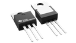
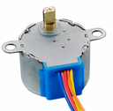
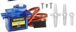
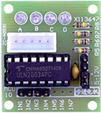
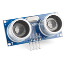

# Milestone 3 - Object manipulation

Instructions, documentation, and helper functions for object manipulation.

In this milestone, you will add new hardware to your robot, and control stepper motors and servo motors to manipulate a 3-inch cardboard cube.
You may also choose to use the ultrasonic distance sensor to detect objects ahead of your robot.

## Files

- `tme441-milestone-3.ino` - Main sketch file with testing code and helper functions.

## Components

| Component | Image | Docs |
|---|---|---|
| L7805CV Linear 5V voltage regulator |  | [Datasheet](https://www.st.com/content/ccc/resource/technical/document/datasheet/41/4f/b3/b0/12/d4/47/88/CD00000444.pdf/files/CD00000444.pdf/jcr:content/translations/en.CD00000444.pdf) |
| 28BYJ-48 Stepper motor |  | [Datasheet](https://www.mouser.com/datasheet/2/758/stepd-01-data-sheet-1143075.pdf?srsltid=AYCX9vLhaZkI2lfVT1FpPYCYxSS_wqnWgwGfcByVUugY74J89JWlhx6N) |
| 5g Hobby servo |  | [Product page](amazon.com/Smraza-Helicopter-Airplane-Control-Arduino/dp/B07L2SF3R4) |
| Stepper motor driver |  | [Product page](https://www.amazon.com/ELEGOO-28BYJ-48-ULN2003-Stepper-Arduino/dp/B01CP18J4A)
| HC-SR04 Ultrasonic distance sensor |  | [Datasheet](https://cdn.sparkfun.com/datasheets/Sensors/Proximity/HCSR04.pdf) |
| Misc. capacitors |

## Instructions

### Build a regulated 5V supply on your breadboard

The stepper motor and servo motor are both rated for 5V input, but they require too much current for the Arduino to supply.
You need to build a circuit on your breadboard that steps the battery voltage down to 5V and doesn't draw current from the Arduino.
You will do this using a component called a Linear Regulator (L7805CV).

1. Bulid a voltage regulation circuit on your breadboard following the example given in the datasheet in Figure 4 (Application Circuits).
2. Test your voltage regulator using a multimeter to confirm that it outputs a stable 5-volt supply.

### Test your stepper motor

1. Mount the stepper motor driver somewhere on your robot board using nylon standoffs and M3 hardware. (The mounting holes don't match up with the large holes on the board, but you can attach it by just one peg, like you did for the Arduino itself.)
2. Connect In1, In2, In3, In4 to digital output pins on the Arduino.
3. Connect your stepper motor driver to your new 5V power supply on the breadboard.
4. Run the included example code to test your stepper motor and confirm that it rotates forwards and backwards by the specified amount.

### Test your servo motor

1. Connect a servo. Make sure to correct the red wire (V_CC) to your new 5V supply, **not the Arduino's 5V supply**.
2. Connect the signal wire to any digital pin on the Arduino.
3. Run the included example code to test your servo and confirm that it rotates forwards and backwards by about 180 degrees.
